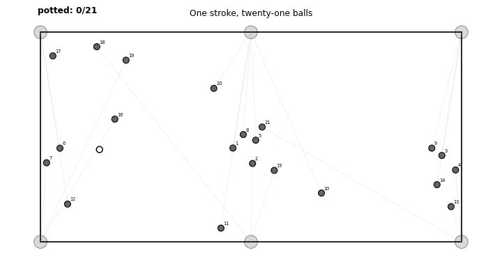

# One Shot, Twenty-One Balls

**Can a single stroke of snooker clear all twenty-one object balls?**

Snooker folklore says no. This repository accompanies a short mathematics
paper showing that, in a fully specified idealized model of billiard
dynamics, the answer is *yes in principle* and *never in practice*. It
contains a computer-assisted proof of the first half and the simulations
behind the second.

<p align="center">
  
</p>

## What is proved

**Theorem (computer-assisted).** For the table layout in
[`proof/witness_21.json`](proof/witness_21.json), every cue stroke with

* speed `V0` within `1e-90` m/s of `V0*`, and
* direction `phi` within `1e-90` rad of `phi*`

pockets all 21 object balls in Model M. So the set of winning strokes
contains a rectangle of area at least `4e-180`. It has positive measure,
but it is unimaginably thin.

The proof is a rigorous replay of the stroke in interval arithmetic,
checked by two independent programs written against different
interval libraries:

| | library | file |
|---|---|---|
| certifier 1 | mpmath (`mpmath.iv`) | [`proof/certify_mpmath.py`](proof/certify_mpmath.py) |
| certifier 2 | Arb (`python-flint`), written independently from the model spec | [`proof/certify_arb.py`](proof/certify_arb.py) |

At every one of the 61 events (21 collisions, 19 cushion rebounds, 21
pocketings), each certifier proves three things for every stroke in the
box:

* the event happens at a unique, transversal instant inside an explicit
  time enclosure;
* nothing else (no other ball pair, cushion, pocket or stop) happens
  first;
* the state after the event is enclosed correctly.

Saved outputs are in [`proof/certificates/`](proof/certificates/).

> **Exact numbers.** All coordinates and shot parameters are the
> binary64 (IEEE double) values that the JSON file decodes to, taken as
> exact rationals. For example, `V0* = 11.9000000000000003552713678800500929355621337890625`,
> not the decimal 11.9. With a box this thin, the difference matters.

## Reproduce the proof (about 2 minutes for certifier 1, under a second for certifier 2)

```bash
pip install -r requirements.txt

# certifier 1: the exact stroke, then the whole box
CERT_PREC=1200 python proof/certify_mpmath.py proof/witness_21.json 0 0
CERT_PREC=1200 python proof/certify_mpmath.py proof/witness_21.json 1e-90 1e-90

# certifier 2 (independent implementation)
python proof/certify_arb.py --r 0
python proof/certify_arb.py --r 1e-90
```

Each run ends with `CERTIFIED` and exits with code 0, or prints
`NOT CERTIFIED: <reason>` and exits with code 1. (On Windows PowerShell,
set the variable first: `$env:CERT_PREC=1200`.)

## Why exact arithmetic is essential

A thin cut turns any small lateral error into a larger change of
direction. Errors grow by a factor of roughly 10 to 70 per collision,
which is about 10^30 or more over the chain. A double-precision
simulation (16 digits) therefore carries no information about the true
trajectory after a few collisions. Earlier versions of this project
built the witness in double precision, and that witness turned out
**not** to be a witness of Model M. It is kept, with an explanation, in
[`archive/float_witness/`](archive/float_witness/). The present witness
was built in 80-digit arithmetic and then certified as above.

## Repository map

```
model/          the physics of Model M
  model_sim.py        fast double-precision engine (used for Monte Carlo)
  model_sim_mp.py     the same engine at 80 digits, no numerical nudges
  make_model_sim_mp.py  regenerates model_sim_mp.py from model_sim.py
proof/          the rigorous part
  witness_21.json     the certified layout and stroke
  certify_mpmath.py   certifier 1
  certify_arb.py      certifier 2
  certificates/       saved outputs (box_search/: wider boxes tried)
construction/   how the witness was found
  witness_bv.py       build-and-verify constructor (grows the chain ball by ball)
  witness_bv_exact.py runs it in the 80-digit engine
  other_chains/       two more 21-ball chains it found (not certified)
  bv_robust_3ball.json  a short chain with a visibly fat success set
simulation/     how rare is rare: Monte Carlo from the opening break
  mc_break.py, mc_results.json, mc_sensitivity.json, fit_summary.txt
figures/        scripts and images
archive/        superseded approaches, kept for provenance
```

## The model in one paragraph

The table is a 3.569 m × 1.778 m rectangle. It holds 22 balls of radius
26.25 mm and has six pockets: a ball is pocketed when its centre comes
within 55 mm of a pocket point. Between events each ball decelerates at
a constant 0.10 m/s² along its direction of motion. Ball-ball collisions
are frictionless with normal restitution 0.95. A cushion reverses the
normal velocity and scales it by 0.90. There is no spin. A stroke is a
pair `(V0, phi)`. Between events the motion is explicit, so a
trajectory is a finite chain of explicit algebraic maps.

## Rebuild a witness from scratch

```bash
python construction/witness_bv_exact.py 7 my_chain.json   # ~6 minutes
CERT_PREC=1200 python proof/certify_mpmath.py my_chain.json 0 0
```

Seed 7 reproduces `proof/witness_21.json`. Other seeds give other chains,
and some seeds dead-end.

## Reproduce the simulations and figures

```bash
python simulation/mc_break.py 30000        # P(k) from the opening break (resumable)
python simulation/mc_break.py 2500 sens    # friction x restitution sensitivity grid
python figures/make_figures.py             # witness layout + P(k) figure
python figures/make_gif.py                 # the animation above
```

## Citation

See [`CITATION.cff`](CITATION.cff). Note that the arXiv preprint
(arXiv:2607.12995, v1) describes the earlier double-precision witness.
